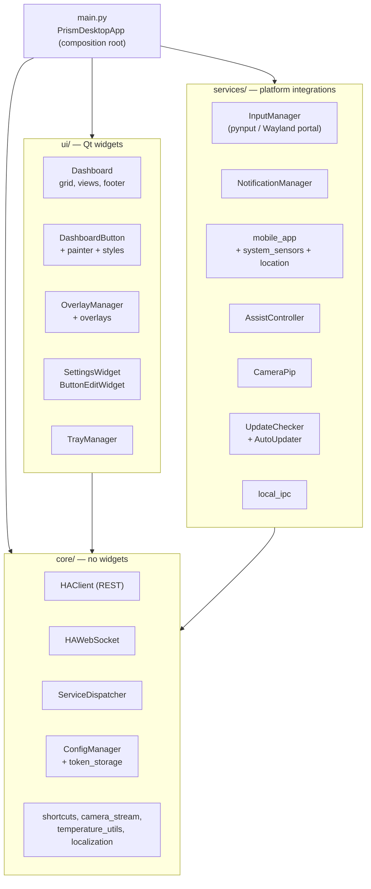
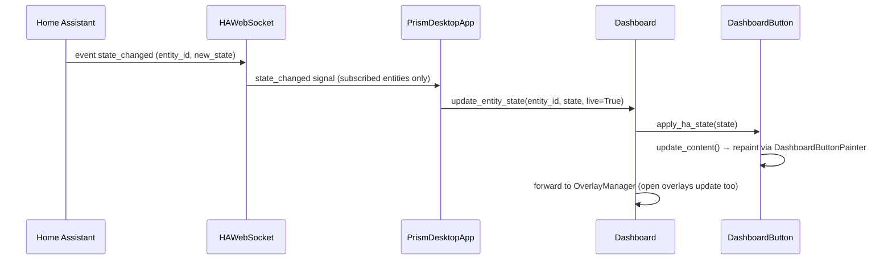

# Architecture

Prism Desktop is a PyQt6 tray app that talks to Home Assistant over its REST
and WebSocket APIs. This page is a map for contributors: where things live,
how a state change reaches a tile, and how a click reaches Home Assistant.

## Layers

- **`core/`** holds the Home Assistant protocol, configuration and pure helpers.
  It never imports `ui` or `services`; CI checks this. `HAWebSocket` is a
  `QObject` so it can emit signals, but `core` has no widgets.
- **`services/`** talks to the operating system and to Home Assistant's
  mobile_app integration: shortcuts, notifications, sensors, location,
  Assist audio, camera streams, updates and the local command socket.
- **`ui/`** is everything drawn. `ui/widgets/` has the tile, its painter and the
  overlays; `ui/managers/` places tiles in the grid and opens overlays.
- **`main.py`** builds all of it, wires the signals, and owns the background
  loops (WebSocket, camera polling, location and sensor reporting).

## One event loop: Qt and asyncio together

The app runs on [qasync](https://github.com/CabbageDevelopment/qasync), so Qt
events and asyncio coroutines share one loop on the main thread. Network code
is `async` (aiohttp); widgets are updated directly from coroutines.

- **Starting a coroutine from a Qt slot:** use `_create_task_safe()` in
  `main.py`. It defers task creation by one loop turn (re-entering qasync from a
  timer callback breaks some distro builds) and keeps a reference through
  `core.utils.keep_task`, because asyncio only holds weak references to tasks.
- **Blocking work** (JPEG decoding, `psutil`, `subprocess`) runs in
  `loop.run_in_executor` or a `QThread` (`core/worker_threads.py`), never on
  the loop itself.
- **Cancellation propagates.** Long-running loops let `asyncio.CancelledError`
  through so `task.cancel()` really stops them.

## State: Home Assistant to a tile

- On connect, `HAWebSocket` authenticates, subscribes to `state_changed` and
  `call_service` events, and, when Prism is registered as a mobile app device,
  to its push notification channel.
- `run_reconnect_loop` reconnects with exponential backoff (1 to 30 s), and
  stops for good when Home Assistant rejects the token, so a wrong token can't
  get the machine IP-banned.
- Initial states come over REST (`HAClient.get_state`) right after connecting.
- A tile shows one entity; a 3D printer tile reads its other entities
  (nozzle, bed, progress, camera) from the dashboard's `_entity_states`.

## Actions: a click to a service call

`DashboardButton` emits `clicked(config)`; `PrismDesktopApp` hands it to
`core/service_dispatcher.py`, which picks the service by tile type (toggle,
`cover.toggle`, `media_player.*`, `script.<name>` with variables, lock with a
hold-to-unlock rule, …) and calls it through `HAClient.call_service`. Tiles that
open an overlay (climate, weather, camera, 3D printer, mower, vacuum, alarm)
emit their own signal instead, and the overlay sends service calls when it is
used.

## Configuration and secrets

- `ConfigManager` reads and writes `config.json` atomically (temp file and
  rename). Where it lives depends on how Prism runs: next to the source in a
  checkout, next to the executable in portable mode, otherwise the platform's
  config folder (`%APPDATA%`, `~/Library/Application Support`,
  `$XDG_CONFIG_HOME`).
- The access token never stays in `config.json`. `core/token_storage.py`
  keeps it in the OS keyring, with an encrypted-file fallback keyed to the
  machine. A plaintext token from an old config is migrated on start.

## Home Assistant mobile_app integration

Prism can register itself as a mobile app device (`services/mobile_app.py`).
That gives Home Assistant a `notify` service for this computer, plus sensors:
CPU and RAM, battery, disk, idle time, screen lock, microphone and camera in use,
and optionally location. Sensor updates go to the device's webhook; the fast
ones (lock, mic, camera) are polled every 10 s but only sent when they change.

## Rendering

Tiles are `QFrame`s styled with generated stylesheets
(`dashboard_button_styles.py`); anything a stylesheet can't do (media
backgrounds, gauges, the sun arc, the 3D printer layout) is painted by
`dashboard_button_painter.py`. Overlays morph out of the tile that opened
them (`BaseOverlay`), and their buttons share one press animation
(`PressableOverlay`).

## Where to look

| To change … | Start in |
|---|---|
| How a tile type looks | `ui/widgets/dashboard_button.py` (`_update_*_view`) and `dashboard_button_painter.py` |
| What a click does | `core/service_dispatcher.py` |
| A popup control (climate, alarm, …) | `ui/widgets/overlays.py`, opened from `ui/managers/overlay_manager.py` |
| Grid placement, spans, drag and drop | `ui/grid_layout_engine.py`, `ui/managers/grid_manager.py` |
| Settings or the button editor | `ui/settings_widget.py`, `ui/button_edit_widget.py` |
| Global shortcuts | `services/input_manager.py`, `core/shortcuts.py` |
| Anything per operating system | [platforms.md](platforms.md) |
| Voice and text Assist | [assist.md](assist.md) |
| Text shown to users | `translations/en.json` (other languages follow it) |
