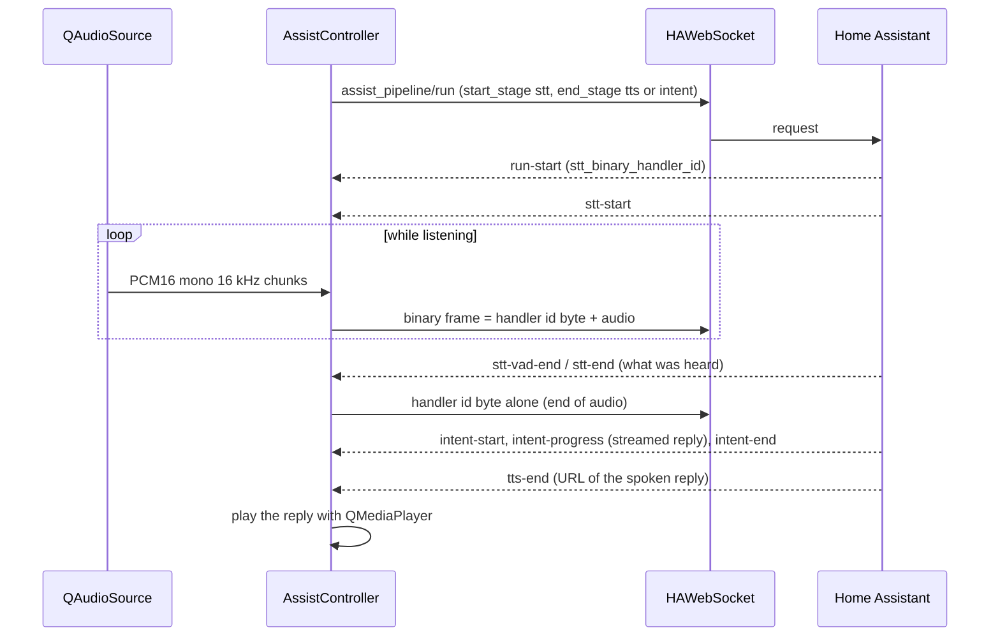

# Assist (voice and text)

Prism talks to Home Assistant's
[Assist pipelines](https://developers.home-assistant.io/docs/voice/pipelines/)
over the WebSocket API, the same way a voice satellite does. Typed and
spoken requests go to your preferred pipeline and conversation agent and share
one conversation.

The pieces:

- **`services/assist_controller.py`** records audio, runs one request at a time,
  and turns pipeline events into signals for the chat.
- **`core/ha_websocket.py`** (`run_assist_pipeline`, `send_stt_audio`) sends
  `assist_pipeline/run` and streams the events back.
- **`ui/widgets/assist_overlay.py`** is the chat window.

## A voice request

- **Audio:** Assist expects 16-bit mono PCM at 16 kHz. Prism asks the
  microphone for exactly that; if the device can't deliver it, the log says so,
  because Home Assistant will usually fail to transcribe the stream.
- **Binary frames:** each audio chunk is sent as a WebSocket binary message
  whose first byte is the `stt_binary_handler_id` from `run-start`. A frame
  with only that byte ends the audio.
- **Spoken replies:** with "Speak replies" on, the pipeline runs to the TTS
  stage and Prism plays the URL from `tts-end`. Otherwise it stops after the
  intent stage.
- **Follow-up questions:** when the agent sets `continue_conversation`, the
  microphone opens again after the reply has been spoken.

## A typed request

Text starts the pipeline at the intent stage with `input.text`, so it reaches
the same agent as voice. Agents that stream (for example LLM agents) send
`intent-progress` events with `chat_log_delta`; Prism shows the assistant's
text as it arrives and skips tool results.

## Errors and timeouts

- A run that sends no event for 90 seconds ends with a timeout message.
- Home Assistant ends a run that hit its own timeout with `run-end` *before*
  the error event, so a run that ends without a result or an error is reported
  as "no response".
- A newer request supersedes an older one: replies from a stopped or closed
  request are dropped instead of appearing in the next conversation.
